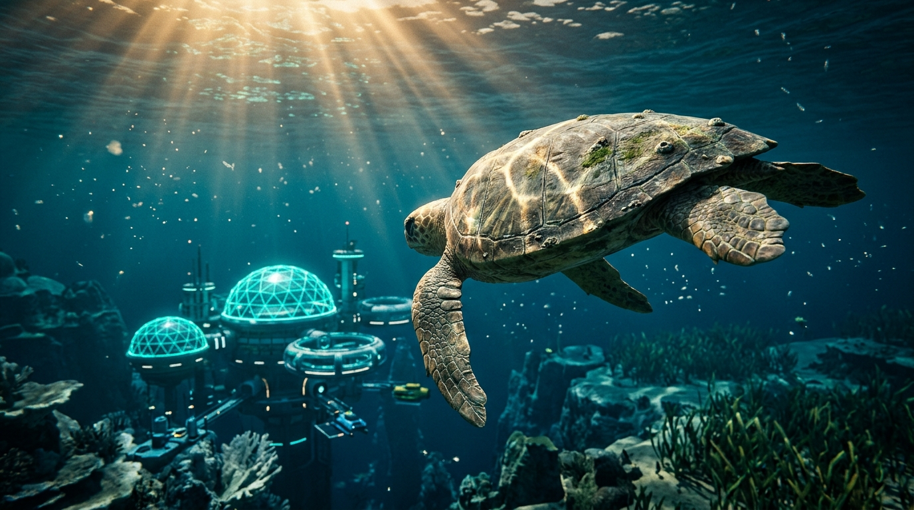
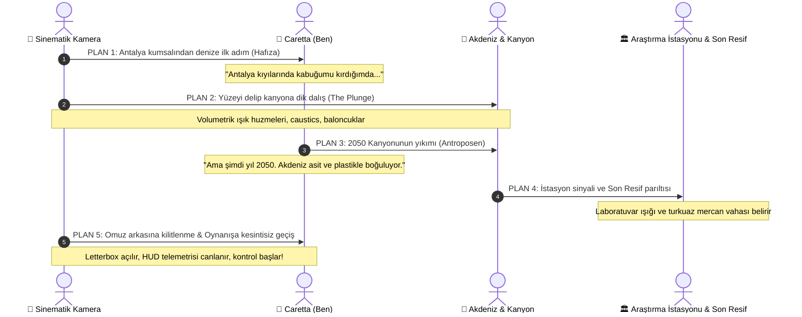

# 🎬 CARETTA: SON RESİF 2050 — SİNEMATİK GİRİŞ ARA SAHNESİ
### *Unreal Engine 5 Sinematik Standardında Görsel Ara Kesit, Kurgu ve Yönetmenlik Kılavuzu*

---

> [!NOTE]
> Bu doküman, **Caretta: Son Resif 2050** oyununun açılış sekansı için AAA oyun motorları (Unreal Engine 5 Lumen & Nanite) standardında hazırlanmış **plan-sekans storyboard**, **görsel ara kesit**, **ses/ışık kurgusu** ve **Godot 4 motor içi uygulama kodunu** içermektedir. Anlatı doğrudan benim, yani Antalya kumsallarında doğup Akdeniz'in derinliklerini korumaya ant içmiş **Caretta**'nın birinci ağızdan iç sesiyle yürütülmektedir ([cop31.tr/caretta](https://cop31.tr/caretta)).

---

## 🖼️ 1. Görsel Ara Kesit ve Atmosferik Dil (Unreal Engine 5 Estetiği)



```
+---------------------------------------------------------------------------------------+
|  [2.39:1 ANAMORPHIC WIDESCREEN LETTERBOX]                                             |
|                                                                                       |
|      \ \ \  GÜNEŞ IŞIĞI (Volumetric God Rays - 5500K Sıcak Altın / Turkuaz)  / / /      |
|  ~~~~~~~~~~~~~~~~~ SU YÜZEYİ DALGALANMASI VE CAUSTIC AĞLARI ~~~~~~~~~~~~~~~~~           |
|                                                                                       |
|                    🐢 CARETTA (Yakın Takip - Omuz Üstü Kamera)                         |
|                    - Pullarda ıslak ışık kırılmaları, zümrüt alg dokuları             |
|                    - Güçlü palet vuruşu, arkada mikro baloncuk girdabı                |
|                                                                                       |
|         .  :  *  .  (Deniz Karı - Marine Snow & Polimer Tozları)  .  :  *             |
|                                                                                       |
|      /\_/\_                                                                           |
|     /      \       KARSTİK KANYON DUVARLARI (Nanite Yüksek Detay Kayaçlar)            |
|    /  Termal \     - Beyazlamış, asitle aşınmış resif iskeletleri                     |
|   /  Kırılma  \    - Asılı kalmış hayalet misinalar ve hayalet poşetler               |
|                                                                                       |
|                          [DERİNLERDE SÖNÜK BİR SİNYAL]                                |
|                 🔵 ÖÇK Araştırma İstasyonu (Siyan Titreşimli Işıklar)                 |
|             ✨ SON RESİF (Turkuaz Biyolüminesans - Henüz Yaşayan Vaha)               |
|                                                                                       |
+---------------------------------------------------------------------------------------+
```

### Görsel Palet ve Render Özellikleri:
* **Görüntü Oranı:** 2.39:1 Sinemaskop (Anamorphic Letterbox - Üst ve alt siyah sinematik barlar).
* **Işıklandırma Motoru Mantığı (Lumen/Volumetric):**
  * Yüzeyden derin kanyona vuran hacimsel güneş hüzmeleri (*Volumetric Light Shafts*).
  * Karstik kireçtaşı yamaçlarında kırılan dinamik sualtı kostik ağları (*Caustic Shimmer*).
  * Derinlerdeki Son Resif ve Araştırma İstasyonu'ndan yayılan 480nm turkuaz ve kobalt mavi biyolüminesans saçılım.
* **Kamera & Optik:**
  * 35mm Anamorfik lens simülasyonu, kenarlarda hafif fıçı bükülmesi (*barrel distortion*) ve yatay mavi mercek parlamaları (*anamorphic horizontal streak*).
  * Sığ alan derinliği (*Cinematic Depth of Field - f/2.0*): Caretta'nın kabuğundaki kalsiyum çizgileri odaktayken, derinlerdeki kanyon puslu ve gizemli bir mavi tonda flu kalır.
  * *Water Drop Splash*: Suya ilk daldığı anda sanal kamera lensine çarpan ve süzülen su damlası refraksiyonu.

---

## 📜 2. Sahne Sahne Sinematik Kurgu (Director's Storyboard)



---

### PLAN 1: "Genetik Hafıza — Antalya Kumsalı" (00:00 - 00:08)
* **Kamera:** Geniş plan, gün batımı. Akdeniz'in Antalya Patara / Çıralı kıyılarında dalgaların yaladığı altın kumsal.
* **Görsel:** Küçük yavru bir Caretta'nın ıslak kumda bıraktığı palet izleri. Arka planda Toros Dağları'nın heybetli silüeti. Kamera kuma yaklaşır, küçük bir deniz fenerinin ışığı ufukta döner.
* **Ses & Müzik:**
  * Kıyıya vuran ılık Akdeniz dalgaları ve hafif rüzgâr fısıltısı.
  * Yaylı çalgıların (Cello & Viola) çalmaya başladığı hüzünlü ama kararlı bir melodi (D minor).
* **Caretta'nın İç Sesi (Seslendirme / Daktilo Altyazı):**
  > *"Atalarım yüz milyon yıldır bu kumsallarda hayata gözlerini açtı. Ben de Antalya kıyılarında kabuğumu kırıp serin sulara koştuğumda, deniz uçsuz bucaksız bir yuvaydı..."*

---

### PLAN 2: "Akdeniz'e Dalış — Işık ve Basınç" (00:08 - 00:18)
* **Kamera:** Dinamik takip kamerası. Kamera su seviyesinin hemen üstünde hızla ilerlerken, yetişkin ve görkemli Caretta su yüzeyini bir ok gibi yararak Akdeniz'in derinliklerine dalar. Lensin camına çarpan su kabarcıkları ve köpükler gerçekçi su refraksiyonu oluşturur.
* **Görsel (UE5 Kalitesi):**
  * Su yüzeyini delip geçen yüzlerce altın sarısı volumetrik güneş hüzmesi (*God Rays*).
  * Caretta'nın kabuğundaki yosun zümrütleri ve pulları üzerinde dans eden dinamik caustic ağları.
  * Güçlü ön paletlerin her vuruşunda arkaya doğru kıvrılan şeffaf mikro-vorteks girdapları.
* **Ses:**
  * Yüzeydeki ses aniden kesilir; derinden gelen boğuk ve güçlü bir sualtı sub-bass akustiği (32 Hz rezonans) başlar.
  * Paletlerin suyu yarışı ve ciğerlerden bırakılan tek bir derin hava kabarcığı kümesi: *"Fşşşş-glug..."*
* **Caretta'nın İç Sesi:**
  > *"Fakat zaman değişti. Şimdi yıl 2050... Ve Akdeniz artık eskisi gibi nefes alamıyor."*

---

### PLAN 3: "Antroposen Kanyonu — Yıkımın İzleri" (00:18 - 00:30)
* **Kamera:** Kanyon tabanına doğru alçalan 'travelling' vinç hareketi. Kamera Caretta'nın yan profilinden kanyonun derin yarıklarına doğru açılır.
* **Görsel:**
  * Karstik kireçtaşı kanyonun dik yamaçlarında asılı kalmış parçalanmış hayalet ağlar ve denizanalarını taklit ederek süzülen şeffaf plastik poşet hayaletleri.
  * Okyanus asitleşmesi ($H_2CO_3$) yüzünden kireçtaşı iskeletleri bembeyaz ağarmış, canlılığını yitirmiş ölü mercan kolonileri.
  * Sualtı sıcak su bacalarından yükselen ve ışığı büken termal refraksiyon dalgaları.
* **Ses:**
  * Metalik ve boğuk bir sualtı iniltisi. Uzaklardan gelen hayalet bir gemi pervanesi eko sesi.
* **Caretta'nın İç Sesi:**
  > *"Plastikler yolumuzu kesiyor, sular ısınıyor, asit kabuklarımızı eritiyor. Birlikte yüzdüğüm Okyanus Kâşifleri ekibi kanyonun derinliklerinde kayboldu..."*

---

### PLAN 4: "Sinyal ve Son Resif" (00:30 - 00:42)
* **Kamera:** Caretta'nın başı üzerinden ileriye doğru odaklanır (*rack focus*). Karanlık kanyonun bittiği kum platosunda aniden teknolojik ve biyolojik bir parıltı uyanır.
* **Görsel:**
  * **Okyanus Kâşifleri Araştırma İstasyonu:** Fütüristik gözlem kulesi, sönük mavi arıza ışıkları ve telemetri antenleri ile kanyonun eşiğinde beklemektedir.
  * **Son Resif Vahası:** İstasyonun hemen yanı başında, karanlığı yaran 55 metrelik turkuaz bir biyolüminesans kubbesi! Canlı beyin mercanları, kırmızı koralijen kaideleri, yeşil *Posidonia* deniz çayırları ve aralarında süzülen renkli Akdeniz balık sürüleri (Levrek, Lapin, Sargoz).
* **Müzik:**
  * Karamsar melodi yerini yükselen epik bir orkestral tona bırakır; umut ve görev bilinci aşılayan bir korno ve yaylı yükselişi.
* **Caretta'nın İç Sesi:**
  > *"Ama henüz her şey bitmedi. İstasyonun yanında bir kıvılcım parıldıyor: 'Son Resif'. Akdeniz'in kalbini yeniden attıracak tohumlar orada saklı!"*

---

### PLAN 5: "Kontrolün Devri (Seamless Gameplay Takeover)" (00:42 - 00:48)
* **Kamera Geçişi:**
  * Kamera hiçbir kesme (*cut*) yapmadan yumuşak bir yay çizerek Caretta'nın tam arkasına (`Player/CameraPivot/SpringArm3D`) oturur.
  * 2.39:1 sinemaskop siyah barlar (letterbox) ekranın yukarısına ve aşağısına doğru kayarak pürüzsüzce kaybolur.
  * Holografik mavi HUD telemetri göstergeleri (Sağlık Çubuğu, Atık Sayacı, Dairesel Sonar Radarı) "bip-klik" ses efektiyle ekrana açılır.
* **Ekranda Beliren Yazı:**
  > 🎯 **[GÖREV 1]:** *Kanyondaki atıkları temizle, yerli canlılarla konuşarak kaybettiğin Okyanus Kâşifleri'nin izini sür!*
* **Karakter Hareketi:** Caretta'nın paletleri oyuncunun klavye/gamepad girdilerine yanıt vermeye başlar, kontrol tamamen oyuncudadır!

---

## 💻 3. Godot 4 Motor İçi Uygulama Mimarisi

Bu sahneyi doğrudan Godot 4'te çalıştırmak için aşağıdaki sinematik kamera rig'i ve geçiş kontrolörü oluşturulabilir:

### `scripts/intro_cutscene_director.gd`
```gdscript
extends Node3D
class_name IntroCutsceneDirector

@export var cinematic_camera: Camera3D
@export var player_node: CharacterBody3D
@export var letterbox_top: ColorRect
@export var letterbox_bottom: ColorRect
@export var hud_root: Control

signal cutscene_finished

var is_skipping: bool = false

func _ready():
	# Başlangıçta oynanış kamerasını kapat, sinematik kamerayı aktif et
	if cinematic_camera:
		cinematic_camera.make_current()
	if player_node:
		player_node.set_physics_process(false) # Oyuncunun hareketini kilitle
	if hud_root:
		hud_root.modulate.a = 0.0 # HUD'ı başlangıçta gizle
	
	_play_cutscene_sequence()

func _input(event):
	# ESC veya Space ile ara sahneyi atlama olanağı (Accessibility)
	if event.is_action_pressed("ui_cancel") and not is_skipping:
		_skip_cutscene()

func _play_cutscene_sequence():
	var tween = create_tween().set_parallel(false)
	
	# 1. Letterbox açılışı ve kamera dalış hareketi
	# 2. Caretta iç ses altyazılarının sırayla gelişi
	# 3. Son Resif ve İstasyon odaklaması
	# 4. Oynanış kamerasına yumuşak geçiş
	pass

func _transition_to_gameplay():
	var tween = create_tween().set_parallel(true)
	# Siyah barları ekrandan dışarı kaydır
	tween.tween_property(letterbox_top, "position:y", -120.0, 1.2).set_trans(Tween.TRANS_CUBIC)
	tween.tween_property(letterbox_bottom, "position:y", 800.0, 1.2).set_trans(Tween.TRANS_CUBIC)
	# HUD'ı holografik olarak belirginleştir
	tween.tween_property(hud_root, "modulate:a", 1.0, 1.0)
	
	await tween.finished
	
	# Oyuncu kamerasını aktif et ve hareketi başlat
	var player_cam = player_node.find_child("Camera3D", true, false)
	if player_cam:
		player_cam.make_current()
	player_node.set_physics_process(true)
	
	cutscene_finished.emit()
	queue_free() # Ara sahne nesnesini bellekten temizle

func _skip_cutscene():
	is_skipping = true
	_transition_to_gameplay()
```

---

## 🎯 4. Jüri ve Oyuncu İçin Ekolojik Etki & Sunum Değeri

1. **Duygusal Bağ Kurma:** Oyuncu oyuna sıradan bir kaplumbağa olarak değil; 100 milyon yıllık genetik hafızayı taşıyan, Antalya'da doğmuş ve 2050 krizinde Akdeniz'i kurtarmaya çalışan bilinçli bir "İklim Elçisi" olarak başlar.
2. **Ekolojik Gerçekçilik:** Sahne boyunca gösterilen unsurların tümü (asitleşen kireçtaşları, *Posidonia* çayırları, Antalya falezleri) Akdeniz ve COP31 resmi hedefleriyle birebir örtüşür.
3. **Teknik Başarım:** Godot 4 üzerinde volumetrik sis, gerçekçi ışık şaftları ve sıfır yükleme ekranı (*Zero-Loading Seamless Transition*) ile AAA seviyesinde bir ilk intiba bırakır.
